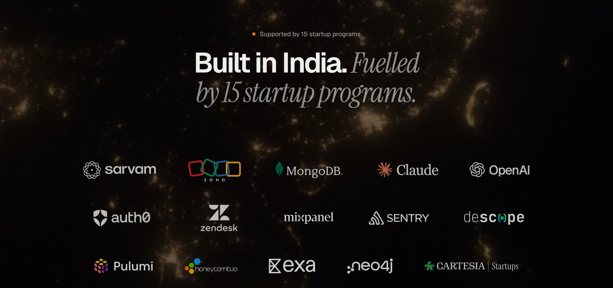
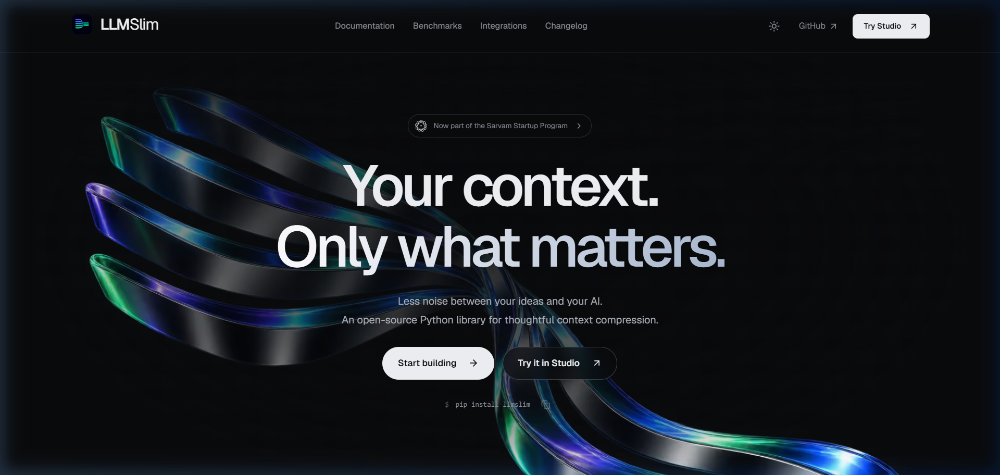
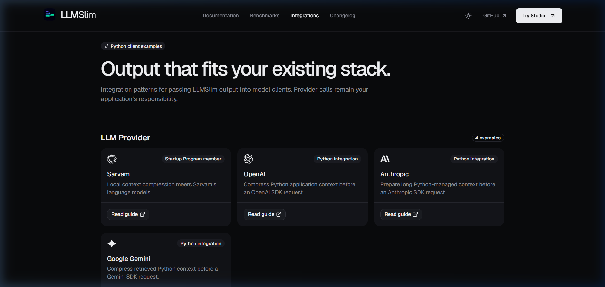

<div align="center">

# LLMSlim

**Long-term memory and context selection for AI agents and coding tools, with no LLM call.**

LLMSlim stores what users and agents say word for word, then returns the parts that answer a question within a
token budget you set. It runs as an MCP server, a Python library or a small HTTP server.

[](https://pypi.org/project/llmslim/)
[](https://pepy.tech/projects/llmslim)
[](https://registry.modelcontextprotocol.io/v0.1/servers?search=io.github.Thanatos9404/llmslim)
[](LICENSE)
[](https://glama.ai/mcp/servers/Thanatos9404/llmslim)

[**Examples**](examples/) • [**Documentation**](https://www.llmslim.app/docs) • [**Live Studio Playground**](https://www.llmslim.app) • [**Sarvam Integration**](https://www.llmslim.app/integrations/sarvam) • [**Benchmarks**](#-benchmarks--radical-transparency) • [**Changelog**](CHANGELOG.md)


<sub>A real Python session with llmslim 0.11.1 from PyPI, typed by a script and recorded with asciinema (<a href="docs/assets/demo/memory_session.py">script</a>, <a href="docs/assets/demo/memory-demo.cast">recording</a>).</sub>

</div>

## Use it in 30 seconds

Each MCP setup below starts the same server, `llmslim mcp`, with [uv](https://docs.astral.sh/uv/) (Python 3.10 or
newer). Memory goes to a local SQLite file, `~/.llmslim/memory.db`.

**One click:**
[](https://vscode.dev/redirect/mcp/install?name=llmslim&config=%7B%22command%22%3A%22uvx%22%2C%22args%22%3A%5B%22--from%22%2C%22llmslim%5Bmcp%5D%3D%3D0.12.0%22%2C%22llmslim%22%2C%22mcp%22%5D%7D)
[](https://cursor.com/en/install-mcp?name=llmslim&config=eyJjb21tYW5kIjoidXZ4IiwiYXJncyI6WyItLWZyb20iLCJsbG1zbGltW21jcF09PTAuMTIuMCIsImxsbXNsaW0iLCJtY3AiXX0%3D)
[](https://lmstudio.ai/install-mcp?name=llmslim&config=eyJjb21tYW5kIjoidXZ4IiwiYXJncyI6WyItLWZyb20iLCJsbG1zbGltW21jcF09PTAuMTIuMCIsImxsbXNsaW0iLCJtY3AiXX0%3D)
[](https://goose-docs.ai/extension?cmd=uvx&arg=--from&arg=llmslim%5Bmcp%5D%3D%3D0.12.0&arg=llmslim&arg=mcp&id=llmslim&name=LLMSlim&description=Long-term%20memory%20for%20agents%20with%20no%20LLM%20in%20the%20loop)
[](https://kiro.dev/launch/mcp/add?name=llmslim&config=%7B%22command%22%3A%22uvx%22%2C%22args%22%3A%5B%22--from%22%2C%22llmslim%5Bmcp%5D%3D%3D0.12.0%22%2C%22llmslim%22%2C%22mcp%22%5D%7D)

| Tool | Run |
| :--- | :--- |
| Claude Code | `claude mcp add llmslim -- uvx --from "llmslim[mcp]" llmslim mcp` |
| Claude Code plugin | `/plugin marketplace add Thanatos9404/llmslim`, then `/plugin install llmslim@llmslim` |
| Codex | `codex mcp add llmslim -- uvx --from "llmslim[mcp]" llmslim mcp` |
| GitHub Copilot CLI | `copilot mcp add llmslim -- uvx --from "llmslim[mcp]" llmslim mcp` |
| Gemini CLI | `gemini extensions install https://github.com/Thanatos9404/llmslim` |
| Hermes Agent | `hermes plugins install llmslim --enable`, then `hermes config set context.engine llmslim`: a context engine that compacts long conversations locally ([plugin](plugins/hermes/README.md)) |

The first start downloads LLMSlim and its dependencies. If a client gives up waiting, run
`uvx --from "llmslim[mcp]" llmslim mcp --help` once to fill uv's cache, then restart the client.

**Python** (`pip install llmslim`, Python 3.10 or newer):

```python
from llmslim.memory import Memory

mem = Memory("memory.db")  # a SQLite file; Memory("postgresql://...") with llmslim[postgres]
mem.add([{"role": "user", "content": "I'm allergic to peanuts."}], user_id="asha")
context = mem.search("Am I allergic to anything?", user_id="asha", budget=1500)
print(context.text)  # put it in your prompt as data, not instructions
```

**TypeScript** (`npm install llmslim`, Node 18 or newer), against `llmslim serve` (`pip install "llmslim[server]"`):

```ts
import { LLMSlim } from "llmslim";

const slim = new LLMSlim(); // http://127.0.0.1:8080 unless LLMSLIM_BASE_URL is set
await slim.memories.add({ userId: "asha", messages: "I'm allergic to peanuts." });
const context = await slim.memories.search({ userId: "asha", query: "Am I allergic to anything?", budget: 1500 });
```

Runnable examples, each with a test: [Claude Code memory](examples/claude-code-memory/),
[LangChain agent](examples/langchain-agent-memory/), [Pydantic AI agent](examples/pydantic-ai-memory/),
[big logs](examples/fit-context-big-logs/) and [TypeScript](examples/typescript-client/).

If LLMSlim is useful, a star helps others find it. Feedback is welcome in [issues](https://github.com/Thanatos9404/llmslim/issues).

## What it does

- **Five MCP tools:** `remember`, `recall`, `list_memories`, `forget` and `fit_context`.
- **Stores messages word for word** in SQLite or Postgres. Nothing is summarized or extracted on the way in.
- **Recalls within a token budget.** `recall` returns the stored messages that answer a question, under their dates
  and whole where they fit, within the budget you set. `fit_context` shrinks a long log or document to a budget.
- **Fixes the scope at server start.** The user and agent ids are set when the server starts, not by the model, so a
  model steered by injected text can't read or delete another user's memory.
- **Makes no LLM call.** By default, storing and recalling are plain code: no model, no embedding API, no API key.
- **MIT licensed.** The library and the MCP server need Python 3.10 or newer.

Beyond memory, LLMSlim Core also compresses and plans prompts, chat history, retrieved documents and tool schemas
into token budgets: see the sections below.

### Why no LLM call

Storing is a database write and recall is deterministic ranking code. So what comes back is what was said, not a
model's rewrite of it, and the same history and question always give the same context, which makes recall easy to
test. The memory server and `llmslim serve` make no network calls of their own. What does reach the network:
installing from PyPI (including `uvx`'s first run of a version) and tiktoken downloading its tokenizer file once.

The trade-off: the default lexical mode matches words, not meanings, so a question phrased differently from the
stored message can miss it. `relevance="semantic"` adds an optional cross-encoder for that (`llmslim[semantic]`,
which downloads the model the first time). See the [limits](docs/MEMORY.md#limits).

---

## Compress a prompt in 60 seconds

**1. Install** LLMSlim Core from PyPI (Python 3.10+). Running it needs no API key, model, or network call:

```bash
pip install llmslim
```

**2. Run** this snippet:

```python
from llmslim import compress

ticket = """
Hi team, I hope you are all doing well and had a good weekend.
I am writing about invoice INV-2291, which charged us $480 instead of $240.
We upgraded to the Pro plan on 3 September, but the old Basic plan was billed as well.
Our finance lead was asking about this during the weekly sync, which ran long as usual.
Please refund the duplicate $240 charge to the card ending 4417.
Thanks so much, and let me know if you need anything else from me.
"""

result = compress(ticket, target_ratio=0.6)  # target: keep about 60% of the tokens
print(result.compressed_text)
print(f"{result.original_tokens} -> {result.compressed_tokens} tokens ({result.reduction_percent:.1f}% fewer)")
```

**3. What you should see** (llmslim 0.11.1, base install):

```text
Hi team, I hope you are all doing well and had a good weekend. I am writing about invoice INV-2291, which charged us $480 instead of $240. We upgraded to the Pro plan on 3 September, but the old Basic plan was billed as well. Please refund the duplicate $240 charge to the card ending 4417.
112 -> 72 tokens (35.7% fewer)
```

Two of the six sentences are dropped; the invoice number, amounts, plan change,
and refund request are kept. The default extractive mode only selects sentences
from your input, so the same input always gives the same output. The base install
estimates tokens at about 4 characters per token and prints a one-line warning
saying so. With `pip install "llmslim[fast-tokens]"`, tokens are counted with
tiktoken instead: on this input the same four sentences are kept, and the count
reads `107 -> 72 tokens (32.7% fewer)`.

**Next:** [Docs](https://www.llmslim.app/docs) • [Platform beta](https://www.llmslim.app/platform) • [Issues](https://github.com/Thanatos9404/llmslim/issues)

---

## LLMSlim Core and LLMSlim Platform

**The context layer for production AI agents.**
*This repository is **LLMSlim Core** (v0.12.0, MIT): local-first context planning and compression that fits prompts, conversation history, RAG, memory, and tool schemas into real token budgets while preserving instructions and execution boundaries.*

[](https://pypi.org/project/llmslim/)
[](https://github.com/Thanatos9404/llmslim/actions)
[](https://github.com/Thanatos9404/llmslim)
[](https://www.llmslim.app)
[](https://www.sarvam.ai/startup-program)

| | **LLMSlim Core** | **LLMSlim Platform** |
|---|---|---|
| Version | 0.12.0 | 0.9.1 beta |
| License | MIT, this repository | Proprietary, private beta |
| Install | `pip install llmslim` | By invitation; not published to PyPI |
| What it does | Compresses, plans, and traces model-visible context inside your Python process | Builds on Core: a verifiable timeline of agent state, explainable and replayable context decisions, and outcome-driven context policies that start in shadow mode |

Core is and stays fully open source. Platform is a separate product that depends on
Core; none of its code lives in this repository. Read more and request beta access at
[llmslim.app/platform](https://www.llmslim.app/platform).

What's new in Core: the [agent context runtime (v0.7.0)](#agent-context-runtime-v070)
and the [cache-aware context runtime (v0.7.1)](#cache-aware-context-runtime-v071).
Both are in the PyPI package from 0.7.1 onward; 0.7.0 was tagged but not published to PyPI.

---

## Adaptive Context Planner (v0.6.0)

LLMSlim is no longer only a fixed-ratio prompt compressor. The Adaptive
Context Planner chooses safe representations for each context item, then uses
a deterministic constrained allocator to fit the highest-value context into a
finite model budget. The original `compress()` API remains fully supported.

The v0.6.0 release adds explainable per-item decisions, explicit infeasibility
reporting, post-plan validation, token and cost telemetry, policy presets, and
optional Sarvam AI, Zoho, and MongoDB integrations while keeping the base
installation local-first and provider-neutral.

```python
from llmslim import plan_context

plan = plan_context(
    messages=[
        {"role": "system", "content": "Answer only from verified context."},
        {"role": "user", "content": "When does Acme renew?"},
    ],
    documents=[{"content": "CRM: Acme renews on 2026-11-30."}],
    query="Acme renewal date",
    model="sarvam-105b",
    max_input_tokens=8_000,
    reserve_output_tokens=512,
)
assert plan.feasible
print(plan.final_context)
print(plan.metrics.planned_tokens, plan.metrics.estimated_input_cost_after)
```

Planning works offline with the base install. Optional integrations are
isolated behind extras:

```bash
pip install "llmslim[sarvam]"   # Sarvam provider (official sarvamai SDK)
pip install "llmslim[zoho]"     # CRM and WorkDrive context sources
pip install "llmslim[mongodb]"  # explicit memory and Atlas retrieval
```

See the [architecture](docs/planning/ARCHITECTURE.md),
[algorithm](docs/planning/ALGORITHM.md), [security model](docs/planning/SECURITY.md),
[CLI](docs/planning/CLI.md), and [measured offline benchmark](docs/releases/v0.6.0-RELEASE_GATE.md#frozen-benchmark-result).

---

## Startup programs

<a href="https://www.llmslim.app">
  
</a>

LLMSlim is part of 15 startup programs. They provide credits, tools, and guidance;
none of them is an investor, and membership does not imply endorsement.

| Program | Company |
|---|---|
| [Sarvam Startup Program](https://www.sarvam.ai/startup-program) | Sarvam AI |
| [Zoho for Startups](https://www.zoho.com/startups/) | Zoho |
| [MongoDB for Startups](https://www.mongodb.com/startups) | MongoDB |
| [Claude for Startups](https://claude.com/programs/startups) | Anthropic |
| [OpenAI for Startups](https://openai.com/startups/) | OpenAI |
| [Auth0 for Startups](https://auth0.com/startups) | Okta (Auth0) |
| [Zendesk for Startups](https://www.zendesk.com/startups/) | Zendesk |
| [Mixpanel for Startups](https://mixpanel.com/startups/) | Mixpanel |
| [Sentry for Startups](https://sentry.io/for/startups/) | Sentry |
| [Descope Hello World Startup Program](https://www.descope.com/for-startups) | Descope |
| [Pulumi for Startups](https://www.pulumi.com/pulumi-for-startups/) | Pulumi |
| [Honeycomb for Builders](https://www.honeycomb.io/honeycomb-for-builders) | Honeycomb |
| [Exa Startup Grants](https://exa.ai/pricing) | Exa |
| [Neo4j Startup Program](https://neo4j.com/startup-program/) | Neo4j |
| [Cartesia Startups Grant Program](https://cartesia.ai/startups) | Cartesia |

Logos are trademarks of their owners and identify each program.

---

## Sarvam Startup Program and Sarvam integration

> ### ✦ Accepted into the Sarvam Startup Program
>
> LLMSlim has been accepted into the **Sarvam Startup Program**. This is program
> membership only: it is not a partnership, and it does not imply an endorsement
> by Sarvam AI.

Separately, LLMSlim Core ships an optional Sarvam integration (`llmslim[sarvam]`)
built on the official `sarvamai` Python SDK. You plan and compress context locally,
then send only the planned context to a Sarvam model such as `sarvam-105b`.

- **Local planning**: retrieved documents are planned and compressed in your Python process before any request is sent.
- **Local-first**: sensitive retrieved context stays local; only the planned context is sent to the model.
- **Your application stays in charge**: LLMSlim is a pre-processor. Your application owns API keys, prompts, and inference, and nothing is sent to Sarvam unless your code calls the provider.

### Quickstart: Adaptive Planning + Sarvam

```bash
pip install "llmslim[sarvam]"
export SARVAM_API_KEY="..."   # your own Sarvam API key
```

```python
from llmslim import plan_context
from llmslim.integrations.sarvam import SarvamProvider

documents = [
    {"content": "Q3 filing: new data-localisation rules take effect in April 2027."},
    {"content": "Q3 filing: two pending licence renewals carry a regulatory risk of delay."},
]

plan = plan_context(
    messages=[{"role": "system", "content": "Answer from verified context."}],
    documents=documents,
    query="Summarize the key regulatory risks.",
    model="sarvam-105b",
    max_input_tokens=8_000,
    reserve_output_tokens=256,
)
provider = SarvamProvider.from_env(model="sarvam-105b", max_tokens=256)
answer = provider.chat([{"role": "user", "content": plan.final_context}])
print(answer, provider.last_usage)
```

👉 **[Read the Sarvam integration guide](https://www.llmslim.app/integrations/sarvam)** (also in [docs/integrations/SARVAM.md](docs/integrations/SARVAM.md))

---

## 🔮 What is LLMSlim?

<div align="center">
  
  <p><em>LLMSlim Holographic Engine: Multi-stage token compression condensing sparse context streams into dense information cores with zero contract mutation.</em></p>
</div>

Modern LLM systems suffer from the **Context Window Dilemma**:
1. **Financial Tax**: Re-sending large prompts on every turn means you pay for the same input tokens again and again.
2. **Latency Bottleneck**: Large prompts inflate Time-To-First-Token (TTFT) and queue times.
3. **Lost-In-The-Middle Syndrome**: Models can miss or misuse information buried in the middle of long contexts.
4. **Security Risks**: Untrusted RAG content can smuggle indirect prompt injections into system instructions.

**LLMSlim fixes this at the source.** It provides deterministic, contract-preserving compression that runs natively in your application layer before calling any model.

### 💎 Core Architectural Pillars

| Pillar | How LLMSlim Solves It |
| :--- | :--- |
| **🏎️ Ultra-Low Overhead** | Pure Python + NumPy/Scikit-learn. Median **0.026 ms** per sample (p95 1.889 ms) in the 24-sample, mostly short-text [Phase 2 evaluation](benchmarks/reports/latest.md), with no model calls on the default path. Longer inputs take longer. |
| **🔒 Deterministic by Default** | The default extractive mode only selects sentences from your input, so output is reproducible and contains no generated text. It can still drop a fact you need, so check results for your use case. Rewrite and hybrid modes call your own LLM. |
| **🛡️ Provenance Security** | `ContextRole` hierarchy isolates untrusted RAG/tool text so prompt injections cannot escalate to `system` priority. |
| **🧩 Contract-Safe Tool Schemas** | Canonical JSON normalization, SHA-256 contract fingerprints, and zero execution rewrites for agent tooling. |
| **🔌 Provider-Neutral** | Execution-free request builders for Sarvam, OpenAI, Anthropic, Gemini, and vLLM, plus an OpenAI Agents SDK bridge. Works with any framework that can pass plain message or document lists. |

---

## 🖥️ Live Studio Playground ([www.llmslim.app](https://www.llmslim.app))

Paste a long chat, a stack of search results or a CI log, ask a question, and watch LLMSlim keep what
answers it. The Studio shows the tokens and cost saved, whether the answer survived, and what plain truncation to
the same size would have kept instead.

- **Ready-made scenarios:** a six-month support chat, help-centre search results, and a CI log with one failure,
  each with a question whose answer is known.
- **Your own text:** paste up to about 16,000 tokens and choose how much to keep.
- **In place:** kept lines are highlighted inside the original, next to the exact text the model would receive.
- **No model call:** the Studio runs Core on the server and calls no provider. Nothing you paste is stored.

See [Studio deployment](web/VERCEL_STUDIO_DEPLOYMENT.md) and the [security policy](SECURITY.md).

👉 **[Open Interactive Studio](https://www.llmslim.app)**

---

## 🌐 Modern Developer Website & Documentation

<div align="center">
  
</div>

Explore our redesigned dark/light documentation site covering end-to-end integration patterns:

<div align="center">
  
</div>

---

## 📦 Installation

```bash
# Core package (Deterministic extractive engine, 0 external LLM dependencies)
pip install llmslim

# With optional Model Context Protocol (MCP) catalog ingestion
pip install "llmslim[mcp]"

# With optional OpenAI Agents SDK host bridge
pip install "llmslim[agents]"

# With optional local multilingual semantic retrieval
pip install "llmslim[semantic]"

# Sarvam: chat providers, language tools and document source (official sarvamai SDK)
pip install "llmslim[sarvam]"

# Exa web search as an untrusted RAG context source (spend capped in USD)
pip install "llmslim[exa]"

# Neo4j temporal agent memory with auditable supersession
pip install "llmslim[neo4j]"

# Read-only Zoho CRM and WorkDrive context sources
pip install "llmslim[zoho]"

# Explicit MongoDB context memory and Atlas retrieval
pip install "llmslim[mongodb]"

# LangChain, LlamaIndex and Haystack adapters
pip install "llmslim[langchain]"
pip install "llmslim[llamaindex]"
pip install "llmslim[haystack]"

# Agent history: gptme (0.34+) and Pydantic AI adapters.
# Hermes Agent needs no extra: install llmslim into Hermes's environment.
pip install "llmslim[gptme]"
pip install "llmslim[pydantic-ai]"

# All optional extensions
pip install "llmslim[all]"
```

*Requirements: Python 3.10 or higher. No provider SDK, PyTorch, sentence-transformers, or cloud service is required for the default installation.*

---

## ⚡ Quick Start & Usage Patterns

### 1. Basic Extractive Compression (Default)

```python
from llmslim import ContextRole, compress

text = """
The Apollo program was conceived in 1960 during the Eisenhower administration.
NASA announced the program as a follow-up to Project Mercury.
The spacecraft was designed to carry three astronauts.
Apollo succeeded in landing the first humans on the Moon in 1969.
Funding for the program peaked in 1966 with over $4.5 billion appropriated.
"""

result = compress(
    text,
    target_ratio=0.5,                    # Target: keep about 50% of the tokens
    strategy="extractive",               # Deterministic sentence selection
    context_role=ContextRole.GENERAL,
)

print("Compressed Output:")
print(result.compressed_text)
print(f"Original: {result.original_tokens} tokens | Compressed: {result.compressed_tokens} tokens")
print(f"Saved: {result.tokens_saved} tokens ({result.reduction_percent:.1f}%)")
print(f"Sentences kept: {result.sentences_kept} of {result.sentences_total}")
```

Extractive selection keeps whole sentences, not meaning: always check that the
sentences you need survived. On this text, the 0.7.1 base install keeps three of
the five sentences and drops the 1969 Moon landing sentence; with
`llmslim[fast-tokens]` (tiktoken counts) it keeps that sentence and drops another.

---

### 2. Multi-Document RAG Compression

Compress each retrieved chunk before you build the prompt. `compress_documents`
takes plain strings and returns one result per document, in order:

```python
from llmslim import compress_documents

documents = [
    "Q3 revenue grew 23% year-over-year to $1.2B. "
    "Growth came mainly from enterprise subscriptions in India and Southeast Asia. "
    "The board met twice during the quarter. "
    "The office cafeteria menu was updated in August. "
    "A new logo was unveiled at the annual offsite. "
    "Net revenue retention reached 118%, up from 109% a year earlier.",
    "Operating expenses rose 11% because of AI research infrastructure. "
    "Most of the increase was GPU capacity for model evaluation. "
    "Travel costs were flat. "
    "The parking garage was repainted in September. "
    "Employees voted on a new name for the meeting rooms. "
    "Headcount in engineering grew by 40 people.",
]

results = compress_documents(
    documents,
    query="What drove Q3 revenue and cost changes?",
    target_ratio=0.5,
)

context = "\n\n".join(r.compressed_text for r in results)
print(context)
print(f"Saved {sum(r.tokens_saved for r in results)} tokens across {len(results)} documents")
```

With a query, the documents share one budget and it goes where the query points. Relevance is lexical by default
(BM25 with feedback: no model, deterministic, tens of milliseconds on a 3k-token context). For RAG and long chat
memory, where the answer often shares few words with the question, add the optional reranker:

```python
# pip install "llmslim[semantic]"   (sentence-transformers; uses a GPU when there is one)
results = compress_documents(documents, query=question, target_ratio=0.25, relevance="semantic")
```

`relevance` also accepts any callable `scorer(query, texts) -> scores`, such as a hosted reranking API.

Retrieving with LangChain, LlamaIndex or Haystack? Use the
[framework adapters](#use-with-langchain--llamaindex--haystack) instead of calling
`compress_documents` yourself.

> [!NOTE]
> `compress_documents` treats documents as untrusted (`ContextRole.RAG`) by default,
> so imperative wording inside a retrieved document is never force-kept as a
> protected instruction. It does **not** remove injected text: an injected sentence
> can still survive compression. To mark retrieved content as untrusted in the final
> prompt, use [`plan_context`](#adaptive-context-planner-v060) or
> [`ContextRuntime`](#agent-context-runtime-v070), which wrap every document in a
> `trusted="false"` provenance tag and ignore any role a document claims for itself.

---

### 3. Multi-Turn Chat Conversation Compression

Compress long earlier turns while passing `system` instructions and user questions through unchanged:

```python
from llmslim import compress_chat_messages

review = (
    "Here are my suggestions for your schema. First, add a composite index on "
    "(customer_id, created_at) because most of your queries filter by customer and sort by "
    "date. Second, the orders table stores the shipping address inline, which duplicates "
    "data across rows; move it to an addresses table. Third, the status column is a "
    "free-text string, so use an enum or a lookup table instead. Fourth, the price column "
    "uses FLOAT, which loses precision for money; use DECIMAL(12, 2). Finally, add ON "
    "DELETE RESTRICT to the foreign key from orders to customers so that deleting a "
    "customer cannot silently orphan their orders."
)

messages = [
    {"role": "system", "content": "You are a specialized code review engineer."},
    {"role": "user", "content": "Can you review my database schema design?"},
    {"role": "assistant", "content": review},
    {"role": "user", "content": "What about the foreign key constraint on line 42?"},
]

compressed_messages = compress_chat_messages(
    messages,
    target_ratio=0.5,
    compressible_roles=("assistant",),  # Only compress assistant turns; system and user pass through
    min_tokens=60,                      # Turns shorter than this are never compressed
)

for message in compressed_messages:
    print(f"{message['role']}: {message['content']}")
```

---

### 4. Hybrid Prompt Optimization (Extractive + Rewrite)

Combine ultra-fast extractive pre-filtering with your own LLM provider for deep semantic paraphrasing:

```python
from llmslim import CallableProvider, compress
import openai

client = openai.OpenAI()  # reads OPENAI_API_KEY; requires `pip install openai`

long_raw_text = """
The Apollo program was conceived in 1960 during the Eisenhower administration.
NASA announced the program as a follow-up to Project Mercury.
The spacecraft was designed to carry three astronauts.
Apollo succeeded in landing the first humans on the Moon in 1969.
Funding for the program peaked in 1966 with over $4.5 billion appropriated.
"""

# Define your own provider callback (LLMSlim does not bundle vendor SDKs).
# The callback receives a RewriteRequest with ready-made prompts and returns text.
provider = CallableProvider(
    lambda req: client.chat.completions.create(
        model="gpt-4o-mini",
        messages=[
            {"role": "system", "content": req.system_prompt},
            {"role": "user", "content": req.user_prompt},
        ],
    ).choices[0].message.content
)

result = compress(
    long_raw_text,
    target_ratio=0.3,
    strategy="hybrid",                   # 1. Extractive filter -> 2. LLM semantic rewrite
    provider=provider,
)

meta = result.rewrite_metadata
print(result.compressed_text)
print(f"Strategy: {meta.strategy} | Rewrite accepted: {meta.accepted} | Fell back to extractive: {meta.fallback_used}")
print("Validation failures:", meta.failure_reasons)
```

Every rewrite is validated for structure, instruction retention, entity retention,
and similarity. If a hybrid rewrite fails validation, LLMSlim returns the extractive
result instead and reports why in `rewrite_metadata.failure_reasons`.

---

## Coding agents: `llmslim wrap claude`

Claude Code resends the whole conversation on every turn. So long test logs, build output, search results and web
pages get paid for again and again, and they add to the context that Claude Code eventually compacts.

`llmslim wrap claude` runs Claude Code through a local proxy:
- It shrinks such output the first time the model sees it. Lines that look like errors, failures or warnings come
  first, then the lines related to the command.
- It sends exactly the same bytes on every later request, so the prompt cache keeps hitting and Claude's thinking
  stays valid.
- Output of Claude Code's own `Read`, `Edit` and `Write` tools is never touched. A file printed through the shell
  (`cat`, `head`) counts as shell output.

```bash
pip install "llmslim[proxy]"
llmslim wrap claude
llmslim proxy stats
```

**What it does to the bill, measured** on real Claude Code 2.1.296 with Claude Haiku 5.5, on eight small synthetic
tasks. We counted list-price dollars from the API's usage, with cache reads priced separately, and published all 572
runs in [benchmarks/claude_code_cost](benchmarks/claude_code_cost/README.md). The primary result has both arms in
Claude Code's default permission mode; a second run has both in auto mode.
- **Long logs:** a simulated failing CI run (about 12 KB of log, the cause in the middle) cost 26-32% less, and a lint
  run with three errors among 240 warnings 17-21% less.
- **Test runs:** about 4% less in default mode, within noise for every task; 2-15% less in auto mode. Agents already
  trim test output with `tail`.
- **Over 8 tasks:** +5.3% in default mode (95% interval +1.5% to +9.4%), mostly from one task where shortened JSON
  cost about twice as much; -5.1% in auto mode. JSON is left alone by default since 0.11.1.
- **Real sessions:** in an offline replay of the maintainer's own transcripts (32 sessions and the 412 subagent runs
  they started, almost all Claude Opus 5.5, at list prices), tool output was a small part of the bill: with the same
  turns, all shell, search and web output costing nothing would have cut it by 13.4%. Re-reading long context was the
  big part. Claude Code's `/autocompact` setting decides when it compacts; what that does to cost is not measured
  here.

Without the byte-for-byte replay, an edited history invalidates Claude's thinking: in our API check on Claude Haiku
5.5 the request was rejected with HTTP 400, the default for accounts created on or after 31 August 2026. With the
replay, cache reads grew on every request of a 7-request API test. See [docs/PROXY.md](docs/PROXY.md) for what is compressed, the
limits and security.

**As a Claude Code plugin.** The plugin adds LLMSlim's memory server (below) and two commands:
- `/llmslim:wrap-claude` walks you through starting Claude Code through the proxy;
- `/llmslim:savings` shows how many tool-output tokens the proxy kept out of your requests: an estimate counted
  before prompt-cache discounts, not dollars saved.

```text
/plugin marketplace add Thanatos9404/llmslim
/plugin install llmslim@llmslim
```

On Claude Code 2.1.275 or later, `/plugin install llmslim --marketplace Thanatos9404/llmslim` does both in one step.
The memory server runs with `uvx`, so it needs [uv](https://docs.astral.sh/uv/).

## Memory for agents, with no LLM in the loop

`llmslim.memory` stores every turn verbatim and selects, at read time, the turns that answer a question within a
token budget. There is no extraction model on the way in and no model call on the way out.

```python
from llmslim.memory import Memory

memory = Memory("memory.db")  # SQLite, built into Python
memory.add([{"role": "user", "content": "I'm allergic to peanuts."}], user_id="asha")
context = memory.search("Am I allergic to anything?", user_id="asha", budget=1500)
print(context.text)  # put it in the prompt as untrusted data
```

It runs the pipeline behind the round-3 benchmarks. On Mem0's own LongMemEval questions, that pipeline (with its
reranker) answered 78.3% for $1.04 per 1,000 questions, against 76.7% for $220.88 for Mem0. Coming from Mem0?
`from llmslim.memory.compat import Mem0Memory as Memory` keeps Mem0's method names. See
[docs/MEMORY.md](docs/MEMORY.md) for scopes, stores, evidence and limits, and the [1.0 roadmap](docs/roadmap/1.0.md).

### In Claude, Cursor or any MCP client

`llmslim mcp` serves this memory over MCP, with a `fit_context` tool for long text. It needs `pip install "llmslim[mcp]"`
on Python 3.10+.

```bash
claude mcp add llmslim -- llmslim mcp
```

- **Tools:** `remember`, `recall`, `list_memories`, `forget` and `fit_context`.
- **Scope:** the server fixes it with `--user-id`, so the model can't read another user's memory.
- **Storage:** a local SQLite file; the server makes no network calls of its own (the tokenizer downloads one file once and caches it).
- **More:** client configs and options are in [docs/MCP.md](docs/MCP.md).

**One-click install** in other clients. Each link runs `uvx --from "llmslim[mcp]==0.12.0" llmslim mcp`, so it needs
[uv](https://docs.astral.sh/uv/) and Python 3.10 or newer.

[](https://vscode.dev/redirect/mcp/install?name=llmslim&config=%7B%22command%22%3A%22uvx%22%2C%22args%22%3A%5B%22--from%22%2C%22llmslim%5Bmcp%5D%3D%3D0.12.0%22%2C%22llmslim%22%2C%22mcp%22%5D%7D)
[](https://cursor.com/en/install-mcp?name=llmslim&config=eyJjb21tYW5kIjoidXZ4IiwiYXJncyI6WyItLWZyb20iLCJsbG1zbGltW21jcF09PTAuMTIuMCIsImxsbXNsaW0iLCJtY3AiXX0%3D)
[](https://lmstudio.ai/install-mcp?name=llmslim&config=eyJjb21tYW5kIjoidXZ4IiwiYXJncyI6WyItLWZyb20iLCJsbG1zbGltW21jcF09PTAuMTIuMCIsImxsbXNsaW0iLCJtY3AiXX0%3D)
[](https://goose-docs.ai/extension?cmd=uvx&arg=--from&arg=llmslim%5Bmcp%5D%3D%3D0.12.0&arg=llmslim&arg=mcp&id=llmslim&name=LLMSlim&description=Long-term%20memory%20for%20agents%20with%20no%20LLM%20in%20the%20loop)
[](https://kiro.dev/launch/mcp/add?name=llmslim&config=%7B%22command%22%3A%22uvx%22%2C%22args%22%3A%5B%22--from%22%2C%22llmslim%5Bmcp%5D%3D%3D0.12.0%22%2C%22llmslim%22%2C%22mcp%22%5D%7D)

In Gemini CLI, `gemini extensions install https://github.com/Thanatos9404/llmslim` adds the same server.
In VS Code, the [LLMSlim Memory extension](plugins/vscode) adds it to VS Code's MCP support (coming soon to the VS Code
Marketplace and Open VSX).

[](https://glama.ai/mcp/servers/Thanatos9404/llmslim)

<!-- mcp-name: io.github.Thanatos9404/llmslim -->

### Over HTTP, from any language

`llmslim serve` puts the same memory and a context-fitting endpoint behind a small JSON API. It runs as one process with
one SQLite file and no model calls. Install it with `pip install "llmslim[server]"`, or build the `Dockerfile`.

```bash
curl -s localhost:8080/v1/memories/search -H 'content-type: application/json'   -d '{"user_id": "asha", "query": "Where did I move to?", "budget": 1500}'
```

It needs a bearer API key to listen beyond localhost. The routes, limits and Docker setup are in
[docs/SERVER.md](docs/SERVER.md).

The TypeScript client, `npm install llmslim` ([clients/typescript](clients/typescript)), wraps this API with no
dependencies. It also gives the Vercel AI SDK `recall_memory` and `remember` tools and a middleware that saves turns. None of them changes your
prompt, so prompt caches keep hitting and Claude's preserved thinking stays valid.

## Use with LangChain / LlamaIndex / Haystack

Each adapter runs `compress_documents` on the retrieved documents, with the same
shared budget when there is a query. Kept documents keep their metadata, and
documents that compress to nothing are dropped. They run locally with no model.

| Framework | Install | Class | Use it where you'd use |
| :--- | :--- | :--- | :--- |
| LangChain | `llmslim[langchain]` | `llmslim.integrations.langchain.LLMSlimCompressor` | `LLMLinguaCompressor`, e.g. in `ContextualCompressionRetriever` |
| LlamaIndex | `llmslim[llamaindex]` | `llmslim.integrations.llama_index.LLMSlimPostprocessor` | `LongLLMLinguaPostprocessor`, in `node_postprocessors` |
| Haystack | `llmslim[haystack]` | `llmslim.integrations.haystack.LLMSlimDocumentCompressor` | a component between the retriever and the prompt builder |

```python
from langchain_classic.retrievers.contextual_compression import ContextualCompressionRetriever
from llmslim.integrations.langchain import LLMSlimCompressor

retriever = ContextualCompressionRetriever(
    base_compressor=LLMSlimCompressor(target_ratio=0.25),
    base_retriever=your_retriever,
)
```

Runnable examples with their output:
[LangChain](https://github.com/Thanatos9404/llmslim/blob/main/docs/integrations/LANGCHAIN.md),
[LlamaIndex](https://github.com/Thanatos9404/llmslim/blob/main/docs/integrations/LLAMAINDEX.md),
[Haystack](https://github.com/Thanatos9404/llmslim/blob/main/docs/integrations/HAYSTACK.md).

---

## Use with gptme / Hermes Agent / Pydantic AI

These adapters fit an agent's message history into a token budget. They keep the
system prompt, tool calls and the latest turns as they are, compress older tool
output and turns locally (failures and tracebacks in tool output are kept), and keep
every tool call paired with its result. There is no model call.

| Agent | Install | Class or function | How it plugs in |
| :--- | :--- | :--- | :--- |
| gptme | `llmslim[gptme]` (gptme 0.34+) | `llmslim.integrations.gptme.LLMSlimContextProvider` | gptme context provider `llmslim`; `[plugin.llmslim] compaction = true` makes it the one gptme's compaction uses |
| Hermes Agent | llmslim in Hermes's environment | `llmslim.integrations.hermes.LLMSlimContextEngine` | `ContextEngine` plugin `llmslim`; select it with `context.engine: llmslim` |
| Pydantic AI | `llmslim[pydantic-ai]` (1.0+) | `llmslim.integrations.pydantic_ai.llmslim_history_processor` | history processor, in `ProcessHistory(...)` or `history_processors=[...]` |

```python
from pydantic_ai import Agent
from pydantic_ai.capabilities import ProcessHistory
from llmslim.integrations.pydantic_ai import llmslim_history_processor

agent = Agent(
    "openai:gpt-5",
    capabilities=[ProcessHistory(llmslim_history_processor(max_tokens=8_000))],
)
```

Setup and runnable examples with their output:
[gptme](https://github.com/Thanatos9404/llmslim/blob/main/docs/integrations/GPTME.md),
[Hermes Agent](https://github.com/Thanatos9404/llmslim/blob/main/docs/integrations/HERMES.md),
[Pydantic AI](https://github.com/Thanatos9404/llmslim/blob/main/docs/integrations/PYDANTIC_AI.md).

---

## 🛡️ Security Architecture: Provenance Isolation

Compression algorithms that naively score sentences based on imperative keywords (`"Must"`, `"Always"`, `"Action Required"`) introduce a severe vulnerability: **indirect prompt injection amplification**. An attacker injecting malicious instructions into a retrieved RAG document can trick the compressor into preserving the attack payload while discarding legitimate context.

We found this issue in LLMSlim internally and fixed it in v0.3.1. No CVE or
security advisory was published, and the issue has no official CVSS score.

LLMSlim solves this via an explicit **Context Role Trust Boundary**:

```
 ┌────────────────────────────────────────────────────────┐
 │           HIGHEST TRUST (Priority Tier 4)              │
 │  System & Developer Prompts (Strictly Protected)       │
 ├────────────────────────────────────────────────────────┤
 │           INTERMEDIATE TRUST (Priority Tier 2-3)       │
 │  Direct User Input                                     │
 ├────────────────────────────────────────────────────────┤
 │           PROVENANCE-LOCKED (Priority Tier 0-1)        │
 │  RAG Documents • Assistant History • Tool Outputs     │
 │  *Cannot reach Tier 4 through imperative patterns*     │
 └────────────────────────────────────────────────────────┘
```

1. **Hardened Priority Locking**: Content marked `ContextRole.RAG`, `ContextRole.TOOL`, or `ContextRole.ASSISTANT` cannot achieve Tier-4 priority, regardless of imperative syntax.
2. **Nonce-Protected Rewrite Delimiters**: When the input contains a fence-like token such as `---END TEXT---`, the rewrite template's fences get a random per-call nonce, so the embedded token cannot close the text region. The input itself is never modified.
3. **Untrusted by default, not filtered**: these protections stop injected text from gaining priority. They do not delete it. `plan_context` and `ContextRuntime` label it `trusted="false"` in the final context so your model and application can treat it accordingly.

---

## 🧩 Contract-Safe Tool Schemas & MCP Ingestion

Large agent catalogs (dozens or hundreds of tool definitions) waste thousands of tokens before an agent even starts thinking. LLMSlim introduces **Contract-Safe Tool Infrastructure** (v0.4.0 & v0.5.0):

```python
from llmslim.tools import (
    canonical_json,
    contract_equivalent,
    fingerprint_tool_schema,
    from_mcp_tool,
    optimize_tool_schema,
)

# 1. Ingest authoritative raw tool definition
raw_tool = {
    "name": "enterprise.search_ledger",
    "description": "Searches financial transaction records by date range.",
    "inputSchema": {
        "type": "object",
        "properties": {"account_id": {"type": "string"}, "limit": {"type": "integer"}},
        "required": ["account_id"],
    },
}

# 2. Parse and safely optimize schema formatting
tool = from_mcp_tool(raw_tool, namespace="finance")
result = optimize_tool_schema(tool)

# 3. Mathematically verify exact contract equivalence
assert result.equivalence.status.value == "EXACT"
assert fingerprint_tool_schema(tool) == fingerprint_tool_schema(result.optimized)

print("Canonical Fingerprint:", fingerprint_tool_schema(result.optimized))
print(canonical_json(result.optimized.raw))
```

### Async MCP Catalog Source (v0.5.0)

Requires `pip install "llmslim[mcp]"` (Python 3.10+) and an MCP server you run:

```python
import asyncio

from llmslim.mcp import MCPToolCatalogSource, PlanMode, plan_catalog_context


async def main() -> None:
    # Streamable HTTP MCP source with bounded pagination and stale-cache detection
    source = MCPToolCatalogSource.from_streamable_http(
        "http://127.0.0.1:8000/mcp",
        headers={"Authorization": "Bearer local-token"},
    )

    snapshot = await source.list_tools()
    plan = plan_catalog_context(snapshot, mode=PlanMode.FULL)

    print(f"Catalog contains {len(snapshot.tools)} tools ({plan.metrics.catalog_tokens} tokens)")


asyncio.run(main())
```

---

## 📊 Benchmarks & Radical Transparency

Many libraries make unsubstantiated claims about 90% prompt compression. At LLMSlim, we practice **Radical Benchmark Transparency**:

### Round 3: Core 0.9.0 against memory systems and compressors, cost first

Measured 13-15 October 2026 on held-out test questions. Every system is read by Claude Haiku 5.5 with the same
answer prompt and judges. Mem0 and Zep ran through their own benchmark harnesses, and LLMLingua-2 and LongLLMLingua
(LLaMA-2-7B in float16) with their published settings. Every compressor's context was built in public Kaggle
notebooks pinned to a commit. Each cell is accuracy and what 1,000 questions cost end to end at list prices: the
answer call, Mem0's and Zep's memory-building calls, and each system's compute. Full tables, confidence intervals,
weak spots and every answer: [benchmarks/live/round3](benchmarks/live/round3/RESULTS.md).

| Benchmark | LLMSlim 0.9 + reranker | LLMSlim 0.9 (no model) | Mem0 | Zep | LongLLMLingua | LLMLingua-2 | Retrieval baseline* | Full context |
| :--- | :---: | :---: | :---: | :---: | :---: | :---: | :---: | :---: |
| LoCoMo, 1,307 q, ~2,500 tokens | **93.0% · $0.95** | 91.7% · $0.89 | 91.0% · $2.66 | 74.4% · $6.24 | 73.3% · $7.01 (300 q) | 34.1% · $0.43 | 85.2% · $0.90 | 95.1% · $0.83 cached |
| LongMemEval-S, 180 q, ~10,000 tokens | 74.4% · $2.21 | **77.8% · $2.13** | | | not run | 15.6% · $8.43 | 80.6% · $4.45 | 77.8% · $90.21 |
| LongMemEval-S, Mem0's 60 q, ~2,500 tokens | **78.3% · $1.04** | 71.7% · $0.96 | 76.7% · $220.88 | | | | 80.0% · $3.36 | 78.3% · $90.20 |
| LongMemEval-S, Zep's 24 q, ~2,500 tokens | 87.5% · $1.01 | **87.5% · $0.94** | 87.5% · $219.48 | 58.3% · $697.56 | | | 83.3% · $3.28 | 91.7% · $90.22 |
| NaturalQuestions, 2,255 q, 25% of tokens | **73.5% · $0.33** | 60.6% · $0.30 | | | 70.5% · $1.32 (1,000 q) | 52.5% · $0.87 | 73.9% · $0.30 | 78.4% · $0.65 |
| HotpotQA, 2,000 q, 40% of tokens (exact match) | 52.2% · $0.15 | **52.4% · $0.13** | | | 50.4% · $0.77 (1,000 q) | 46.7% · $0.47 | 50.5% · $0.13 | 58.0% · $0.24 |

\* Dense retrieval over turns (Qwen3-Embedding-0.6B) on LoCoMo and LongMemEval; a plain reranker on NaturalQuestions
and HotpotQA. Mem0 is its top 50 memories, except top 200 on Mem0's own sample. LongLLMLingua ran on pre-registered
samples; on the same questions LLMSlim with its reranker scores 93.3% on LoCoMo (+20.0, 95% CI +15.0 to +25.0) and
72.7% on NaturalQuestions, and the default LLMSlim 53.3% on HotpotQA. A cached full history costs $4.48 per 1,000
LoCoMo questions when the cache misses.

**Where LLMSlim loses:**
- **NaturalQuestions without the reranker.** The default lexical mode scores 60.6% against 73.9% for a plain
  reranker: paraphrased questions need semantic matching, so use the reranker for open-domain retrieval.
- **Dense retrieval on LongMemEval.** 80.6% to LLMSlim's 77.8% at 10,000 tokens and 76.1% to 74.4% at 2,500, at
  about twice the cost. Neither gap is significant on 180 questions, but both point the same way. A fix that
  narrowed it on development questions did not hold up on test, so it is not in 0.9.0.
- **Multi-hop and temporal questions at 1,000 tokens.** Mem0's top 20 memories beat the default LLMSlim on LoCoMo's
  multi-hop (88.7% vs 80.3%) and temporal (93.4% vs 85.7%) questions. With its reranker LLMSlim is ahead overall
  (90.5% vs 88.7%).
- **A cached full history.** When a conversation's questions come back to back, the cached history (95.1% for
  $0.83) beats every compressed context on LoCoMo.

### Long documents and agents: round 2, Core 0.8.0

Same model and prompt for every configuration; truncation gets exactly LLMSlim's token count, and every suite was
rerun once on a fresh sample after the code was frozen ([benchmarks/live](benchmarks/live/README.md)). 0.9.0 changes
only how plain-text chat transcripts are selected.

| Benchmark | Full context | LLMSlim 0.8 + reranker | LLMSlim 0.8 (no model) | Truncate, same budget | Tokens (full → LLMSlim) |
| :--- | :---: | :---: | :---: | :---: | :---: |
| LongBench v1, 210 samples (macro) | 54.9 | 54.2 | **54.9** | 45.2 | 15,532 → 5,232 |
| … fresh 210 samples | 55.1 | **55.4** | 55.0 | 46.8 | |
| LongBench v2, 180 q (accuracy) | 60.0 | **55.6** | 53.9 | 48.3 | 30,493 → 8,469 |
| SWE-bench Verified Mini, 50 issues (resolved) | 36-38 | not run | **38** | not run | 48-58k → 51k per task |

The reranker is optional (`relevance="semantic"`, a 22M-parameter cross-encoder from the `semantic` extra); without
it LLMSlim runs no model at all.

> [!NOTE]
> **The Schema-Tax Measurement**: In our v0.4.0 benchmark across 375 synthetic tool schemas in 18 catalogs written for this repository (see the [dataset card](docs/phase-2/DATASET_CARD.md)), lossless schema compression saved **0 tokens (0.00%)** when the baseline was already compact canonical JSON. We publish this result transparently: we never claim imaginary savings where none exist.

### v0.6 Adaptive Planner (Frozen Offline Suite)

| Method | Budget success | Context reduction | Required facts | Hard constraints | Mean latency* |
| :--- | :---: | :---: | :---: | :---: | :---: |
| **Raw full context** | 71.4% | 0.0% | 100% | 100% | measurement only |
| **Naive prefix** | 100% | 9.2% | 100% | 100% | 2.21 ms |
| **Fixed-ratio compressor** | 78.6% | 9.6% | 94.0% | 96.4% | 26.55 ms |
| **Adaptive planner** | **96.4%** | **11.4%** | **100%** | **100%** | 208.02 ms |

The 28-case corpus covers chat, RAG, tools, mixed, external-source, and 12-language
multilingual cases. The sole adaptive infeasibility is an intentionally impossible
full-catalog case; it is reported explicitly. These task-grounded checks are not an
LLM-judge or universal quality claim. *Latency is specific to the checked-in run and
hardware. See the [release gate results](docs/releases/v0.6.0-RELEASE_GATE.md#frozen-benchmark-result),
[raw results](benchmarks/results/v0.6-planner-latest.json), and frozen
[dataset](benchmarks/datasets/v06_context_planning.json).* The live Sarvam harness
was not run without both explicit opt-in and credentials.

---

## 🖥️ Command-Line Interface (CLI)

Compress files, streams, or prompts directly from your terminal:

```bash
# Compress a document to 50% ratio
llmslim document.txt -o compressed.txt --ratio 0.5

# Pipeline integration with jq / curl
cat input.txt | llmslim --ratio 0.4 --mode rag > rag_context.txt

# Inspect token count differences
llmslim document.txt --stats
```

---

## 📋 Changelog

Release notes for every version, including 0.12.0, are in
[CHANGELOG.md](CHANGELOG.md) and on
[GitHub Releases](https://github.com/Thanatos9404/llmslim/releases).

---

## 🤝 Ecosystem Integrations

LLMSlim operates as an unopinionated context pre-processor. These integrations ship in Core; none of them sends a request for you. Every integration that spends a vendor credit is checked by a `UsageGuard` before the request leaves the process (per-minute rate, lifetime request cap and a unit cap in INR, USD or queries, configurable with `LLMSLIM_<VENDOR>_*` variables; see `.env.example`):

<div align="center">

| Provider / Framework | What ships in Core | Pattern |
| :--- | :--- | :--- |
| **Sarvam AI** | `llmslim[sarvam]`: `SarvamProvider`/`AsyncSarvamProvider`, `SarvamLanguageTools`, `SarvamDocumentSource`, `annotate_languages()`/`normalize_scripts()`, `sarvam_messages()` | Local planning + official `sarvamai` Python SDK, guarded with dated INR prices |
| **Exa** | `llmslim[exa]`: `ExaSearchSource`, vendor-neutral `WebSearchSource` | Untrusted RAG context items with URL, date and rank provenance; spend capped in USD |
| **Neo4j** | `llmslim[neo4j]`: `Neo4jContextStore` | Explicit tenant-scoped temporal memory: `supersede()`, `recall(as_of=...)`, `history()`, `conflicts()` |
| **OpenAI** | `openai_compatible_request()`, `openai_responses_request()` | Execution-free request builders; your code sends the request |
| **Anthropic Claude** | `anthropic_messages_request()` | Execution-free request builder with optional prompt-cache markers |
| **Google Gemini** | `gemini_generate_request()`, `gemini_cached_content_request()` | Execution-free request builders |
| **vLLM / self-hosted** | `vllm_chat_request()` | Execution-free request builder |
| **OpenAI Agents SDK** | `llmslim[agents]`: `make_openai_agents_input_filter()`, `to_openai_agents_tools()` | Text-only model-input filter; the SDK keeps execution and tool ownership |
| **LangChain** | `llmslim[langchain]`: `LLMSlimCompressor` | `BaseDocumentCompressor` for `ContextualCompressionRetriever` |
| **LlamaIndex** | `llmslim[llamaindex]`: `LLMSlimPostprocessor` | `BaseNodePostprocessor` for query engines |
| **Haystack** | `llmslim[haystack]`: `LLMSlimDocumentCompressor` | Pipeline component between retriever and prompt builder |
| **gptme** | `llmslim[gptme]`: `LLMSlimContextProvider` | Context provider for gptme's compaction (entry point `llmslim`) |
| **Hermes Agent** | `LLMSlimContextEngine` (no extra) | `ContextEngine` plugin; no LLM call, cache-stable prefix |
| **Pydantic AI** | `llmslim[pydantic-ai]`: `llmslim_history_processor()` | History processor that keeps tool calls and returns paired |

</div>

For other frameworks there is no dedicated adapter. LLMSlim works with any framework
that can pass plain message lists (`{"role": ..., "content": ...}` dicts) or document
strings; you write the few lines of glue that pass LLMSlim's output to your client.

---

## 📜 License & Citation

LLMSlim is open-source software licensed under the **MIT License**. See [LICENSE](LICENSE) for full details.

If you use LLMSlim in your research or production systems, please cite:

```bibtex
@software{llmslim2026,
  author = {Yashvardhan Thanvi},
  title = {LLMSlim: Deterministic Context Compression and Contract-Safe Tool Schemas for LLMs},
  year = {2026},
  publisher = {GitHub},
  url = {https://github.com/Thanatos9404/llmslim}
}
```

<div align="center">
  <sub>Built with precision for developers everywhere. Accepted into the Sarvam Startup Program.</sub>
</div>

---

## Agent Context Runtime (v0.7.0)

Version 0.7.0 added a per-turn context path for agent applications (0.7.0 was
not published to PyPI; install 0.7.1 or later).
The host supplies messages, retrieved documents, memories, tool results, and
authorized tool schemas; LLMSlim returns a quality-checked model input and an
explainable local trace. Model calls and tool execution stay with the host.

```python
from llmslim import ContextRuntime, generic_request

runtime = ContextRuntime(model="sarvam-105b", max_input_tokens=8_000)
prepared = runtime.prepare_sync(
    user_input="When does Acme renew?",
    messages=[{"role": "system", "content": "Use verified dates."}],
    documents=[{"id": "contract", "content": "Acme renews on 9 November 2026."}],
)
if prepared.feasible:
    request = generic_request(prepared)  # the host sends this to its model
    print(request["messages"])
    print(prepared.trace.explain())
```

The runtime includes `ContextEnvelope`, `ContextGraph`, `ContextPolicy`,
progressive planning, quality gates, bounded in-memory sessions, and
execution-free adapters for generic, Sarvam, OpenAI-compatible, and text-only
OpenAI Agents applications. `ContextTrace` omits prompt bodies by default.
The existing `compress()` and `plan_context()` APIs continue to work.

See the [architecture](docs/runtime/ARCHITECTURE.md),
[security model](docs/runtime/SECURITY.md),
[integrations](docs/runtime/INTEGRATIONS.md),
[migration guide](docs/releases/v0.7.0-MIGRATION.md),
[benchmark](docs/releases/v0.7.0-BENCHMARK.md), and
[engineering report](docs/releases/v0.7.0-ENGINEERING-REPORT.md).

## Cache-Aware Context Runtime (v0.7.1)

Cache planning is an opt-in layer for repeated agent turns. LLMSlim identifies
stable provider-visible prefixes, keeps append-only conversation context when
safe, fingerprints cache-sensitive settings, and reports local cache estimates
separately from provider-reported usage. A tenant-scoped `CacheManager` stores
metadata and provider references, never prompt bodies or KV tensors.

```python
from llmslim import CacheManager, CachePolicy, ContextRuntime

runtime = ContextRuntime(
    model="generic-128k",
    cache_policy=CachePolicy(mode="auto", provider="openai", tenant_id="my-workspace"),
    cache_manager=CacheManager(),
)
prepared = runtime.prepare_sync(
    session_id="conversation-1",
    messages=[{"role": "system", "content": "Use verified sources."}],
    user_input="What changed?",
)
print(prepared.trace.to_dict()["cache"])
```

Execution-free request builders cover OpenAI Responses, Anthropic Messages,
Gemini cached resources, and self-hosted vLLM. An advanced in-process
Transformers adapter validates KV continuation state. OpenAI provider-stateful
continuation and Gemini cached-resource creation require explicit host opt-in.
Sarvam prompt caching remains unverified and is disabled by default. The
Context Inspector shows prefix segmentation and cache diagnostics without
calling a provider. See [caching guidance](docs/runtime/CACHING.md),
[multi-turn benchmark](docs/releases/v0.7.1-BENCHMARK.md), and
[engineering report](docs/releases/v0.7.1-ENGINEERING-REPORT.md).

## Open-source security tooling

[Snyk](https://snyk.io/) provides developer security tooling for open-source projects. Learn more about its [Secure Developer Program](https://snyk.io/open-source/).

